# 🌙 말랑 홈 · 말랑 천문 테마

마리나라(Marinara Engine)용 **홈 화면 개인 확장**과 그에 맞춘 **앱 전체 테마**예요.
빈티지 천문 잡지 · 보딩패스 · 우표 · 별자리 느낌으로, 홈 화면부터 채팅방 · 사이드바 · 팝업까지 한 세트로 꾸며 줘요.

| 파일 | 내용 |
|---|---|
| `mallang-home-1.28.0.personal-extension.zip` | 말랑 홈 (홈 화면 개인 확장) |
| `extension.js` · `extension.css` · `manifest.json` | 말랑 홈 파일 (깃허브 확장 관리자로 바로 설치할 때) |
| `Mallang_Celestial_Theme.json` | 말랑 천문 테마 (앱 전체 테마) |

둘은 따로 써도 되고, 같이 쓰면 제일 예뻐요.

---

## 미리보기

### 말랑 홈

  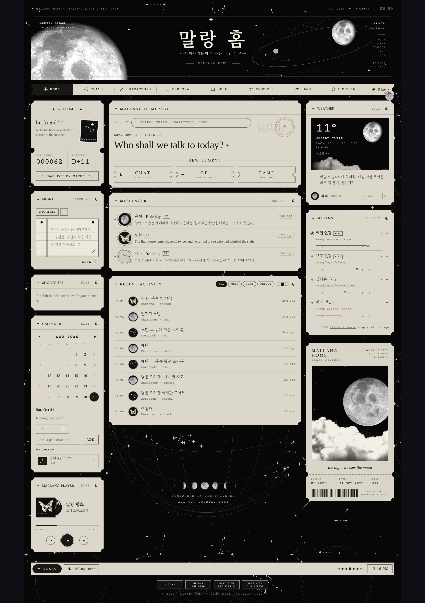
  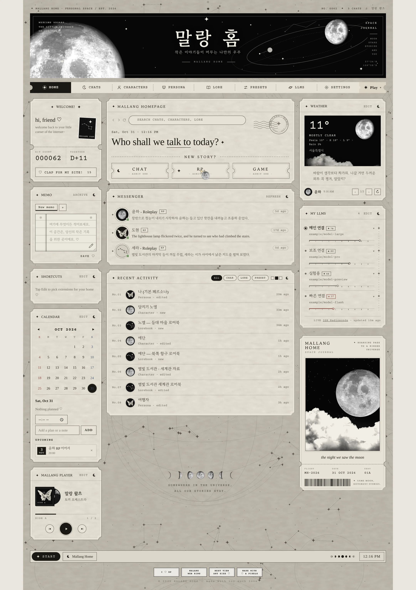

### 말랑 천문 테마

  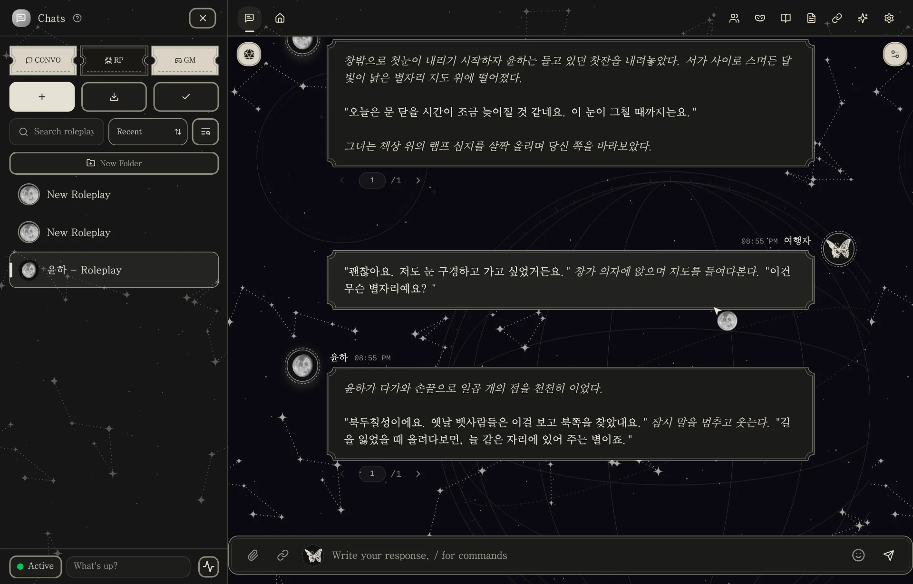
  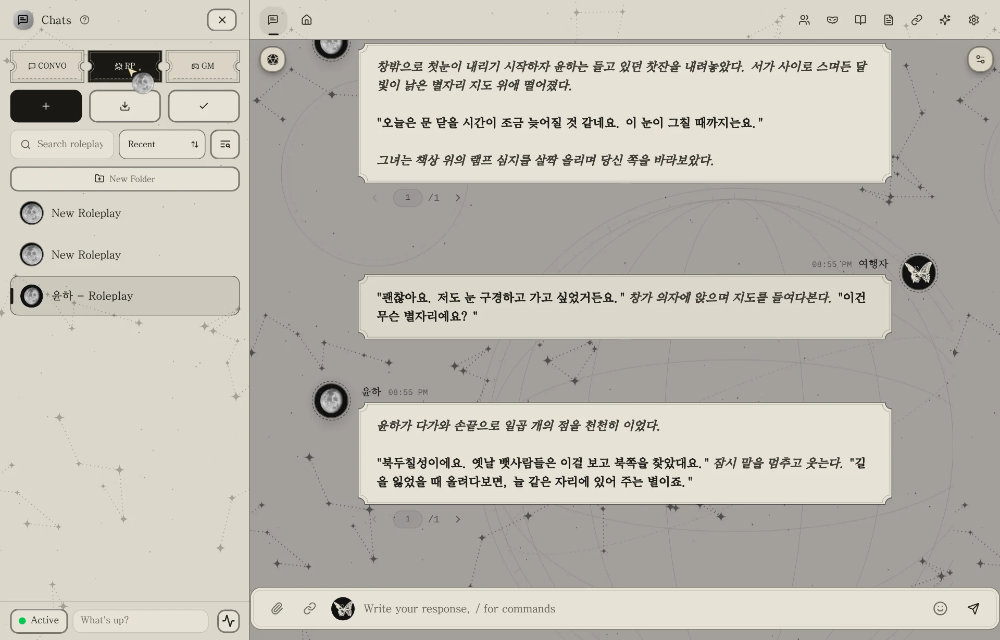

**대화 모드 · 말풍선**

  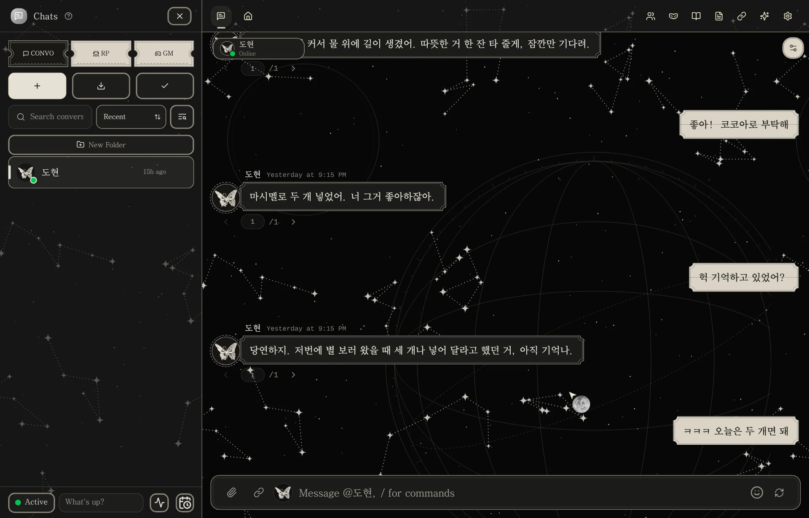
  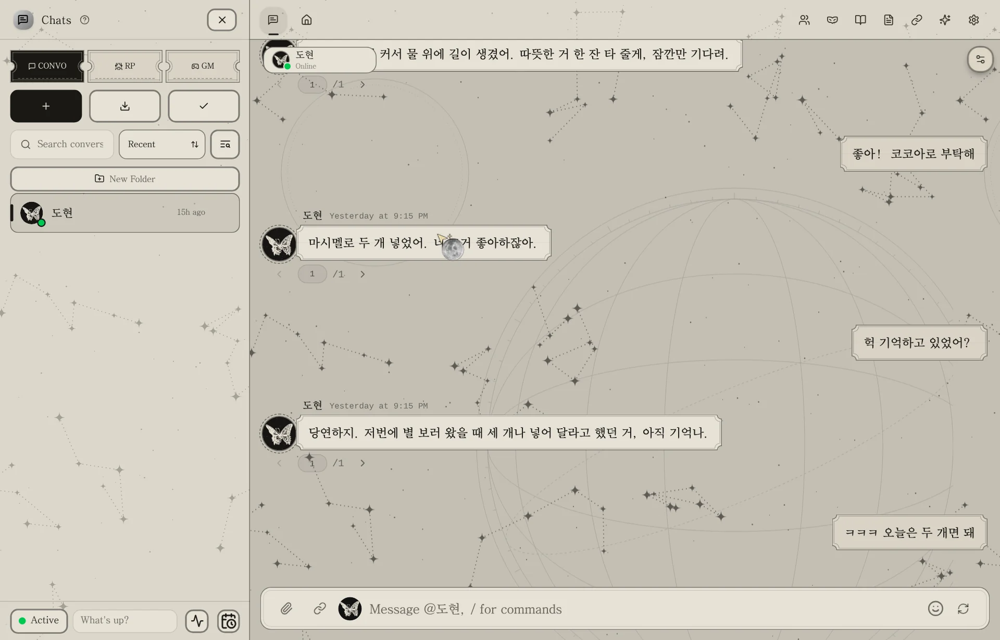

**대화 모드 · 클래식**

  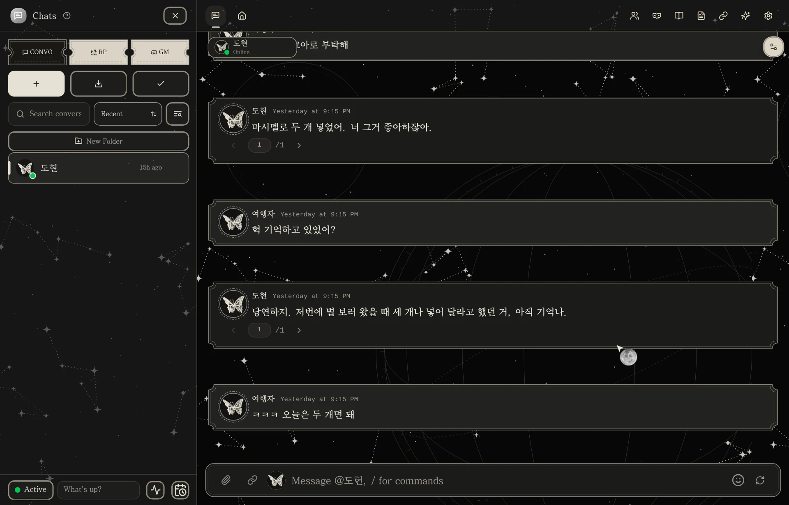
  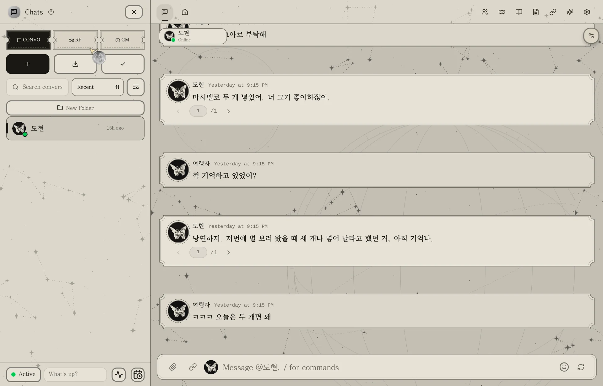

**캐릭터 탭 · 확인창**

  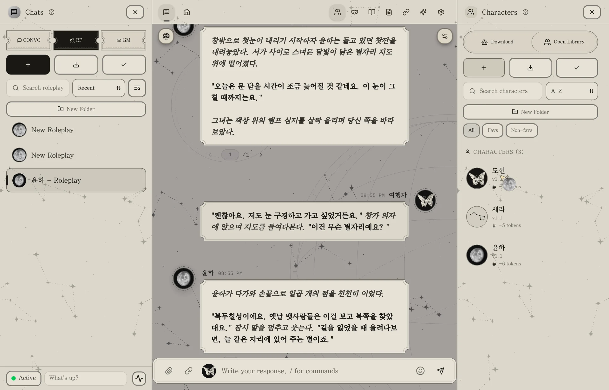
  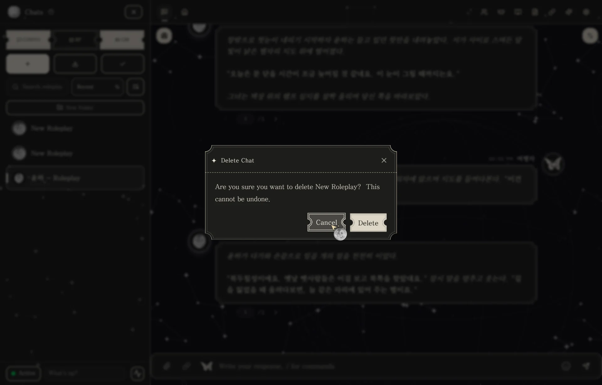

### 폰

  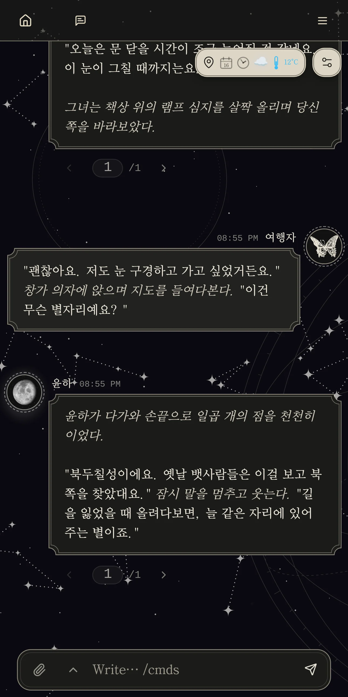
  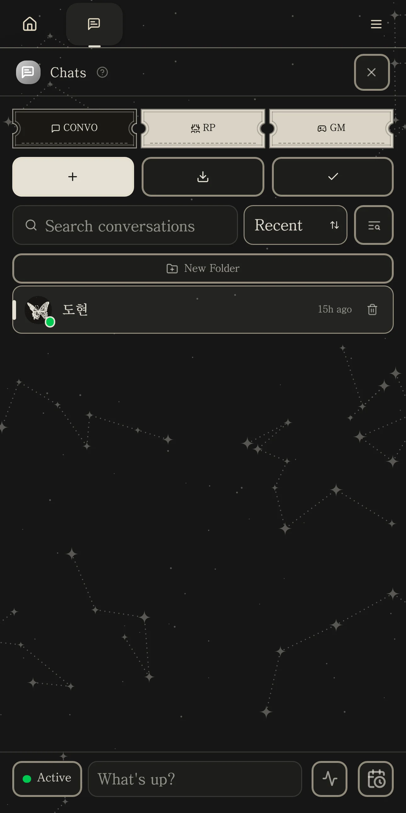
  
  

  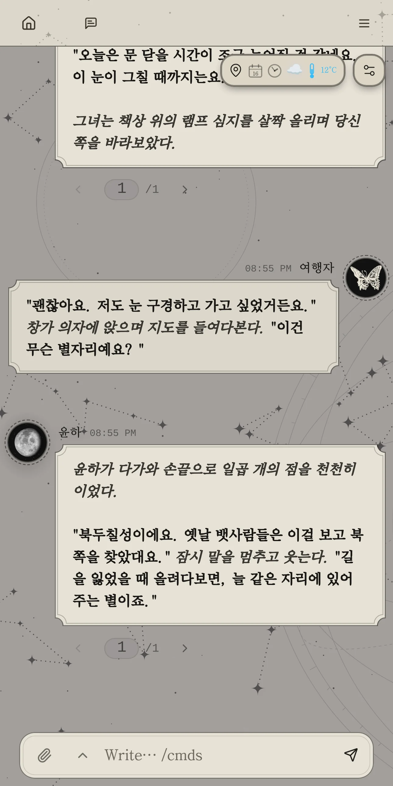
  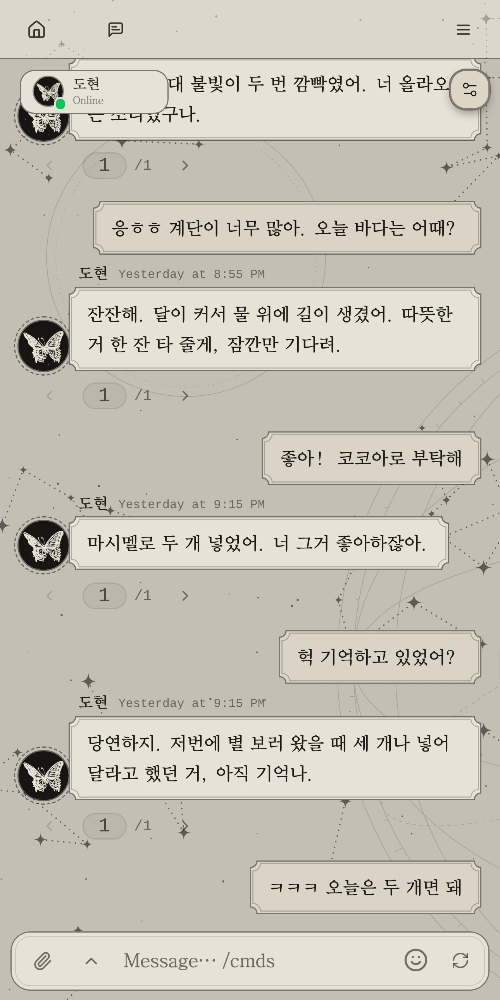
  
  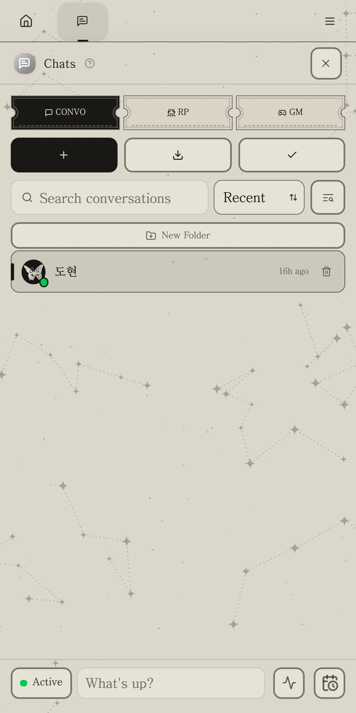

> 스크린샷 속 캐릭터와 대화는 전부 예시예요.

---

## 설치 방법

### 말랑 홈 (개인 확장)
1. 위의 `mallang-home-1.28.0.personal-extension.zip` 을 내려받아요. (압축은 풀지 않아도 돼요)
2. 마리나라 **설정 → 개인 확장 → 설치** 에서 zip 파일을 골라요.
3. 실행 허락 창이 뜨면 허락해 줘요.
4. 새로고침하면 홈 화면이 말랑 홈으로 바뀌어요.

원래 홈으로 돌아가고 싶으면 말랑 홈 아래쪽 **기본 홈 보기**(또는 START 메뉴의 Classic Home)를 누르면 돼요.

### 말랑 천문 테마
1. 위의 `Mallang_Celestial_Theme.json` 을 내려받아요.
2. 마리나라 **설정 → 테마** 에서 불러오기로 json 파일을 골라요.
3. 불러온 **말랑 천문 테마**를 켜요. (불러오기만 하면 자동으로 켜지지 않아요)
4. 새로고침해요.

글꼴은 마리나라에서 고른 글꼴을 그대로 따라가요. (만든 사람은 고운바탕을 써요)

---

## 말랑 홈에 들어있는 것

- 달 사진 배너 · 메뉴 탭 · 3단 카드 화면
- 웰컴 카드 · 방문자 카운터 · 박수 버튼
- 홈페이지 창: 검색 · **NEW STORY** (대화 / 롤플 / 게임 바로 시작)
- 메신저(최근 채팅) · 최근 활동(캐릭터 · 페르소나 · 로어북 · 프리셋)
- LLM 목록 + IGX 실시간 점수 (키 필요 없음)
- 메모장 · 확장 바로가기
- 위젯: 날씨(캐릭터가 날씨 한마디 해 줌) · 달력 · 음악 플레이어 · 사진
- **API 영수증**: 오늘·이번 달 요청 수, 토큰, 예상 금액, 월말 예상 (모델 단가는 직접 적어요)
- **크레딧**: 구글 클라우드 무료 크레딧(적은 잔액에서 쓴 만큼 차감 · 서비스 계정(또는 구글 로그인)을 연결하면 구글 모니터링이 센 Vertex 토큰으로 에이전트까지 정확히) · 중계 API 잔액·이번 달 사용액(One API / New API 기반) · 나노지피티 충전 잔액 + 구독 남은 토큰
- 사진 위젯: 내 기기 · 서버 갤러리 · **채팅방 갤러리**(롤플 방에서 만든 그림) 중에서 골라 넣기
- **Play 메뉴**: 마리나라 홈 브라우저의 탭 · 북마크를 한곳에 (위 메뉴 / 카드 중 고르기)
- START ▸ Arrange 로 카드 위치를 마음대로 옮기기
- 화면이 좁으면 한 줄로 쌓아 보여 줘요 (START ▸ Phone view 에서 Mini PC 로 바꿀 수 있어요)

## 말랑 천문 테마에 들어있는 것

- 다크 / 라이트 둘 다 지원
- 상아 종이 · 숯색 **티켓 말풍선** (모서리 펀칭 + 겹테두리)
- CONVO · RP · GM 입장권 탭, 티켓 모양 확인창 · 버튼
- 사이드바 · 오른쪽 패널 · 상단바 별자리 배경
- 동그란 프사 + 점선 원, 사진 없는 프사는 캐릭터 = 달 · 페르소나 = 나비
- 달 모양 마우스 커서
- 폰(아이폰 사파리 포함)에서도 가볍게 돌아가도록 만든 말풍선

---

## 알아두면 좋은 것

- 말랑 홈은 채팅 · 캐릭터를 **읽기만** 해요. 사진 위젯에 올린 사진만 서버 갤러리의 「말랑 홈 사진」 폴더에 저장돼요.
- 말랑 홈이 바깥에서 불러오는 것: 글꼴(Google Fonts), 날씨(Open-Meteo), 지역 검색(OpenStreetMap), LLM 점수(IGX · aistupidlevel.info).
- 날씨 한마디는 날씨 위젯에서 고른 연결(LLM)로 만들어져요.
- 마리나라 버전이 바뀌면 일부 모양이 달라질 수 있어요.
